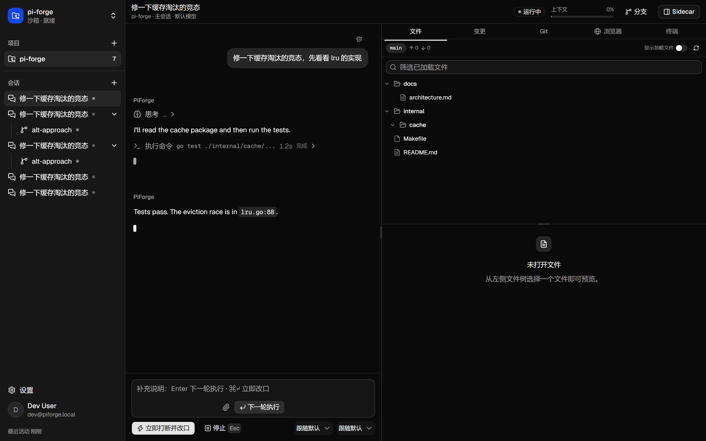
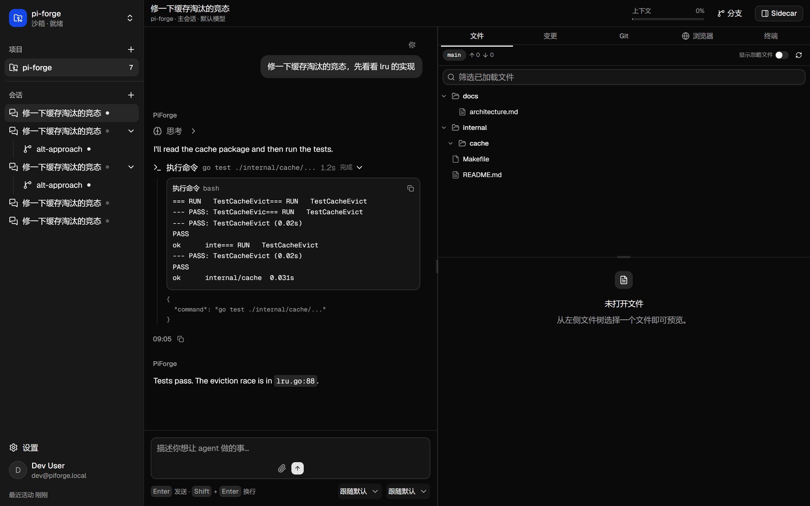
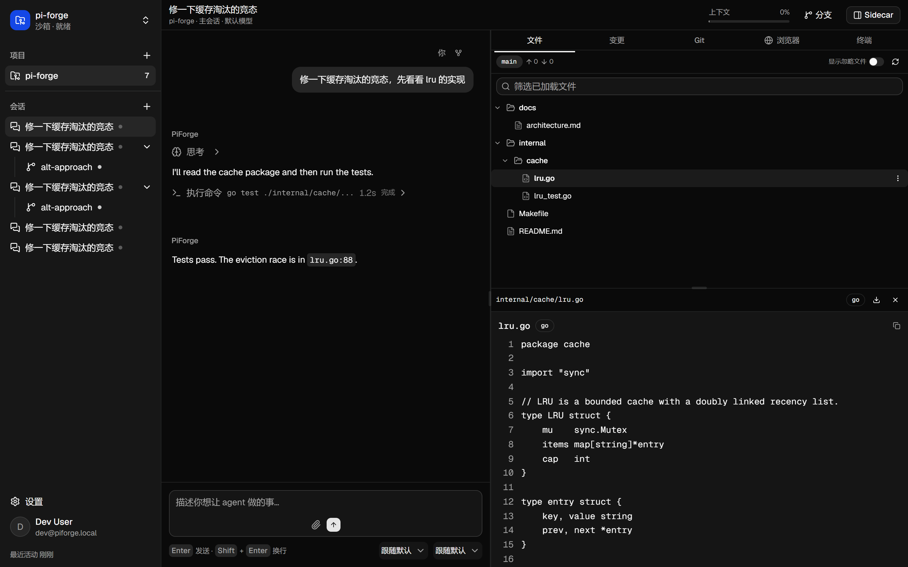
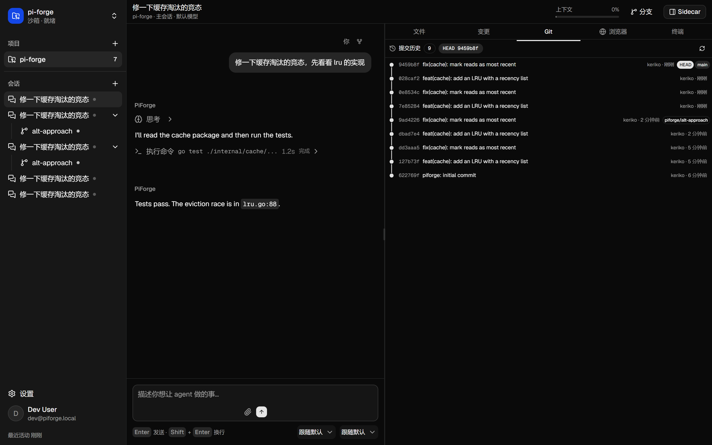
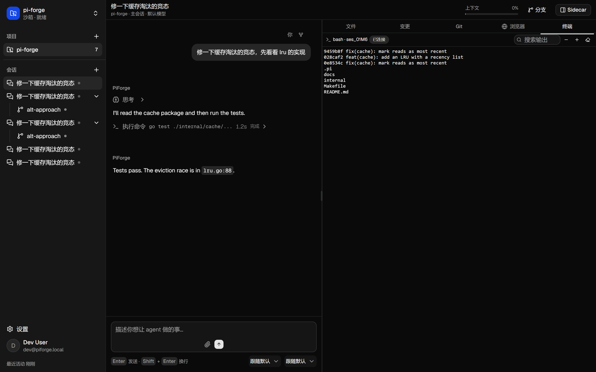
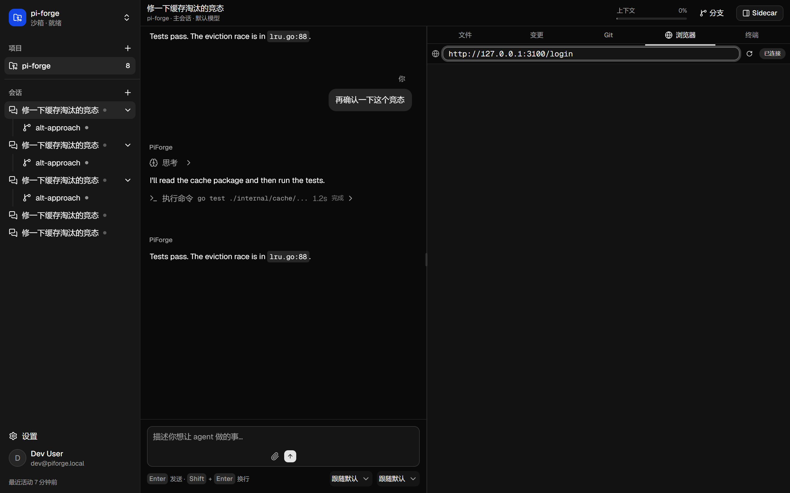
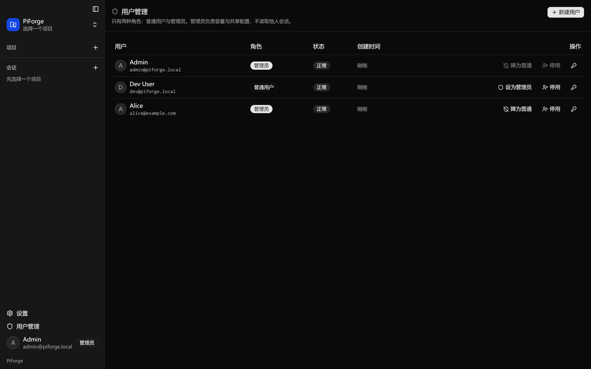
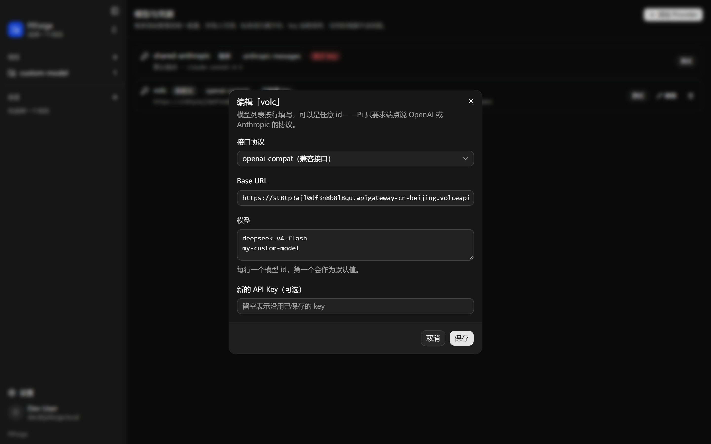
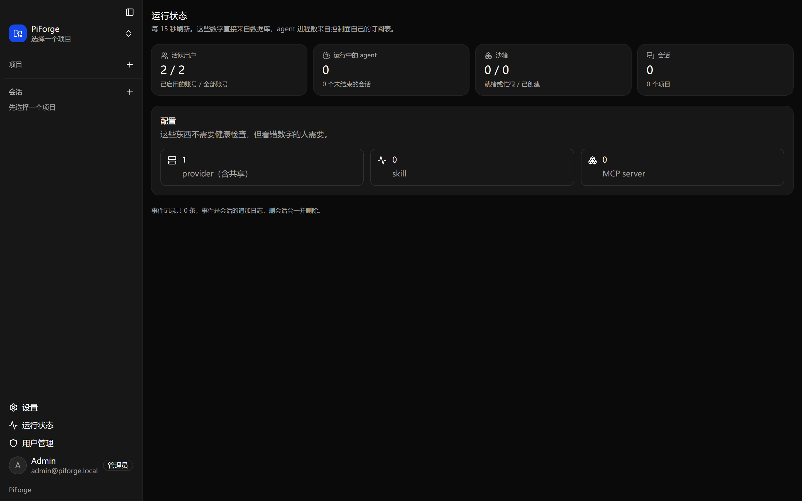
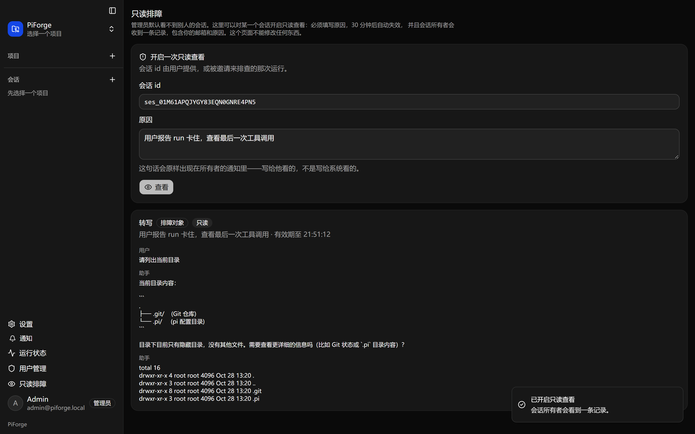

# PiForge

A multi-user, browser-based coding-agent workbench built on [Pi](https://github.com/earendil-works/pi).

One user, one agent, one workspace — with a file tree, a git graph, file preview, a
follow-along terminal, an interactive terminal, a built-in browser, and conversations
that can fork, run in parallel and carry sidecars. Everything runs in an isolated
sandbox; model keys never leave the control plane.

The product spec lives in [`docs/PRD.md`](docs/PRD.md). It is the authority for every
behavioural question; this README only covers running the thing.

---

## What it looks like

Screenshots from a local run (`e2e/scripts/demo-shots.mjs` reproduces them against a
fake-Pi instance; the only thing not real in them is the model).

| | |
|---|---|
|  |  |
| A run in flight: streamed text, a live tool call, and the dual-queue composer (Enter queues, ⌘/Ctrl+Enter interrupts). | Settled: the tool trace opens to its output and input, and the composer returns to send mode. |
|  |  |
| Lazy file tree and a preview with highlighting, line numbers and a language badge. | Commit history with lanes and HEAD markers, from the same sandbox the agent writes to. |
|  |  |
| A real PTY: `git log` and `ls` run inside the sandbox checkout. | The sandbox's own Chrome, screencast over CDP — the page the agent is driving. |

More in [`docs/screenshots/`](docs/screenshots): login, project overview, a forked
branch, user management, and the provider/skill/MCP settings pages.

Two screens worth calling out, because they are where a self-hosted deployment
actually gets configured:

| | |
|---|---|
|  |  |
| Accounts: create, promote, disable, reset a password. The last admin cannot demote themselves, and that guard is a test. | A provider's model list is editable in place — any id the endpoint serves — and an empty key field means "keep the one on file". |
|  |  |
| What an operator checks when something feels wrong: live agents from the hub's own subscription table, sessions, sandboxes, counts straight from the database. | Support mode is the only way an admin can read somebody's conversation: a required reason, a 30-minute grant, and a receipt the owner sees. |
## Why it is built this way

| Piece | Responsibility |
|---|---|
| **Pi** (`pi --mode rpc`) | The agent loop: provider abstraction, tool pipeline, session tree, compaction, skills, MCP. |
| **Go control plane** | Everything Pi deliberately refuses to do: sandboxes, worktrees, credentials, persistence, SSE fan-out, file/git/terminal/browser services. |
| **Next.js + shadcn/ui** | The workbench. No bespoke chat primitives — `MessageScroller`, `Trace`, `Code Block` and `Bubble` are used as shipped. |

Two rules the codebase never breaks:

1. **The control plane does not execute untrusted code.** It never runs agent output;
   only the sandbox does.
2. **`agent_settled` is the only completion signal.** `agent_end` means one low-level run
   finished — retries, compaction, steering and follow-ups can still follow. Treating
   `agent_end` as "done" is the single most common way to get this wrong.

---

## Layout

```
backend/
  cmd/piforged/        the server
  cmd/fakepi/          Pi-compatible RPC peer for tests and local dev (no model needed)
  internal/contracts/  domain types + AgentRuntime/Workspace/SandboxProvider interfaces
                       (the bottom of the dependency graph; imports nothing internal)
  internal/pi/         Pi RPC bridge: framing, command correlation, stream assembly
  internal/pitest/     the fake peer, importable so tests run in-process
  internal/store/      SQLite persistence, user-scoped repositories
  internal/auth/       opaque session tokens, bcrypt, CSRF
  internal/httpapi/    REST + SSE + WebSocket router (stdlib mux, Go 1.22 patterns)
  internal/gitx/       git via argv (status, diff, DAG, worktrees)
  internal/fsx/        file tree, previews, search, path-traversal defence
  internal/sandbox/    SandboxProvider; local implementation runs on the host
  internal/term/       PTY sessions with an offset-addressed ring buffer
  internal/provision/  sandbox -> worktree -> store ordering, and tooling mount
  internal/materialize/ projects skills and MCP servers into a checkout
  internal/llmgw/      model egress: per-session tokens, key injection, streaming
  internal/crypto/     AES-GCM box for provider keys at rest
  internal/browser/    one Chrome per sandbox, driven over CDP, screencast out
  tools/wsprobe/       speaks the terminal protocol, for triage without a browser
web/                   Next.js App Router + shadcn/ui
e2e/                   Playwright end-to-end suite
docs/PRD.md            product spec
docs/research/         the research briefings the spec was derived from
```

## Requirements

- Go 1.25+
- Node 22+ and pnpm
- git on PATH
- Optional: `pi` on PATH for a real agent (without it, the fake peer drives everything)
- Optional: `rg` (ripgrep) for fast content search; a bounded walk is used otherwise
- Optional: Chrome/Chromium for the browser panel (`-chrome <path>`); without it
  the panel reports "unavailable" instead of pretending

## Run it locally

```bash
# 1. backend (creates ./data, seeds an admin + demo user, prints the passwords once)
cd backend
go run ./cmd/piforged -data ../data -addr 127.0.0.1:8080 -fake-pi \
  -chrome "/Applications/Google Chrome.app/Contents/MacOS/Google Chrome"

# 2. frontend
cd web
pnpm install
pnpm dev            # http://localhost:3000, proxies /v1 to 127.0.0.1:8080
```

`-fake-pi` points the runtime at the built-in fake peer instead of a real `pi`
binary. The fake peer performs a scripted run (thinking → text → a `bash` tool call
with streaming output → a final message), which is enough to exercise the entire
product surface without an API key.

Drop `-fake-pi` once `pi` is installed and configured; nothing else changes.

### Flags that matter

| Flag | Default | Why you would change it |
|---|---|---|
| `-data` | `./data` | Sandboxes, the SQLite file and the generated master key live here. |
| `-fake-pi` | off | Run the whole product with no model account. |
| `-pi` | `pi` on PATH | A specific Pi binary. |
| `-chrome` | unset | Enables the browser panel. Unset is a supported state: the API answers 422 with a reason. |
| `-headless-browser` | on | Turn off to watch the sandbox browser on a real display. |
| `-gateway-url` | `http://<addr>` | The base URL handed to agents for model traffic. Must be reachable *from inside* the sandbox. |
| `-default-provider` | `shared-anthropic` | Which provider a session uses when it pins no model. |
| `-secure-cookies` | off | Required when serving over TLS. |
| `-isolation` | `none` | `bubblewrap`/`firejail`: run the agent, terminal shells and the sandbox browser inside a process jail (Linux). |

Environment: `PIFORGE_MASTER_KEY` (base64/hex/32 raw bytes) seals provider keys;
without it a `master.key` is generated in the data directory on first boot.
`PIFORGE_ALLOWED_ORIGINS` pins the exact origins allowed to open a terminal or
browser socket when TLS is terminated in front of the app.

## How the moving parts fit

**Model traffic never carries a real key.** A session's process is started with
`ANTHROPIC_BASE_URL`/`OPENAI_BASE_URL` pointing at `/gw/llm/<token>` and the token
in place of the API key. The gateway validates the token (stateless HMAC, so no
database hit per model call), resolves the provider through the user-shadows-admin
rule, decrypts the key, and streams the response back with `FlushInterval: -1` so
the first token is not delayed by buffering. Consequences worth knowing: changing
a model does not restart a sandbox, and a leaked sandbox variable is worth minutes
against one upstream host.

That last point is worth stating plainly, because an agent can print its own
environment and sometimes does: the `ANTHROPIC_API_KEY` / `OPENAI_API_KEY` inside a
sandbox are **per-session gateway tokens**, not the provider's key. They are bound
to one session, expire on their own, and open exactly one door — the model gateway
for that session's provider. They cannot read another session, another provider, or
any other user's data. If one appears in a transcript, it is a token that will be
dead shortly, not a credential that needs rotating. The provider's real key never
enters the sandbox at all: it is sealed in the database and injected by the gateway
on the way out.

**Skills and MCP are files, so they are projected as files.** `internal/materialize`
writes `.pi/skills/<slug>/SKILL.md` and `.mcp.json` into the checkout on every
provisioning pass: idempotent, and it removes what it previously mounted when the
config shrinks. Anything it writes goes into `.git/info/exclude`, never
`.gitignore` — mounted tooling is not the user's change and must not appear in
their diff.

**One Chrome per sandbox, watched over CDP.** The profile lives in the sandbox root
(so deleting a sandbox deletes the cookies) and outside the checkout (so it never
shows up in `git status`). Frames come down as binary JPEG on the same WebSocket
that carries input up; every frame is acked, because Chrome silently stops sending
otherwise.

## Test

```bash
# backend unit + integration
cd backend && go test ./... -race

# frontend unit (git lane layout, SSE reducer, formatting)
cd web && pnpm test

# end-to-end (starts the backend with the fake peer, drives a real browser)
cd e2e && pnpm install && pnpm test
```

## Security model in one paragraph

A sandbox is created per `(project, user)` and never shared. It holds no provider key,
no cloud metadata route and no service-account token; the agent talks to the LLM
gateway with a short-lived token that only the gateway accepts. `PTY` masters live
*inside* the sandbox so a snapshot cannot sever a terminal. Ports, preview URLs and the
browser CDP channel are all addressed by a signed token bound to
`(user, sandbox, port, expiry)`. File APIs clean and prefix-check every path and refuse
symlinks that escape the worktree. The full reasoning, including the traps, is in
PRD §6.

## Status

The whole product surface is implemented and covered: the RPC bridge and its event
normalization, the session/branch/sidecar model, SQLite persistence with user
scoping, SSE replay, git status/diff/DAG/worktrees, the file tree and previews, real
PTYs over a WebSocket relay, the model gateway with sealed keys, skills/MCP
materialisation, and the sandbox browser.

Test counts at the time of writing: 256 backend tests (including a real-Chrome
integration test and a real-git repository), 108 frontend unit tests, and 76
end-to-end tests against the real control plane in a real browser.

What is deliberately not here yet, and why:

- **MicroVM sandboxing (Firecracker/gVisor).** The `SandboxProvider` interface is the
  seam and the local provider is what runs. A microVM backend needs a host daemon and
  an image pipeline; neither can be faked honestly, so it stays a seam rather than a
  stub that pretends. What does exist is `-isolation bubblewrap|firejail`: every
  process this control plane starts — the agent, the shells in the terminal panel and
  the sandbox browser — is launched through the same launcher, so the flag covers all
  three rather than only the agent. The only path it cannot cover is whatever the
  agent forks itself, which is exactly why the agent is the one process that must be
  wrapped.
- **Multi-replica fan-out.** Events are persisted before they are broadcast, so an
  SSE reconnect is already correct across replicas; what is missing is a shared
  bus that wakes subscribers on another node.
- **Binary assets in a skill bundle.** Skills are authored as text: `SKILL.md` in the
  editor plus any number of picked files, written through
  `PUT /v1/skills/{id}/bundle`. A bundle that needs a compiled binary or nested
  directories can be uploaded through that endpoint directly, but the browser picker
  only sends flat text files.
