# PiForge

A self-hosted, multi-user coding-agent workbench. A Go control plane runs
[Pi](https://github.com/earendil-works/pi) agents inside per-project sandboxes and serves a
browser UI: transcript, file tree, diff view, terminal, built-in browser, and an operator
console with quotas, egress policy and an audit trail.

Model keys stay in the control plane. Agents run in a container, not on the host.

Status: working, self-hosted, single host today. The Kubernetes provider is implemented and
was run against a real cluster, but is not the default. Read [Limits](#limits) before
deploying.

## How it works

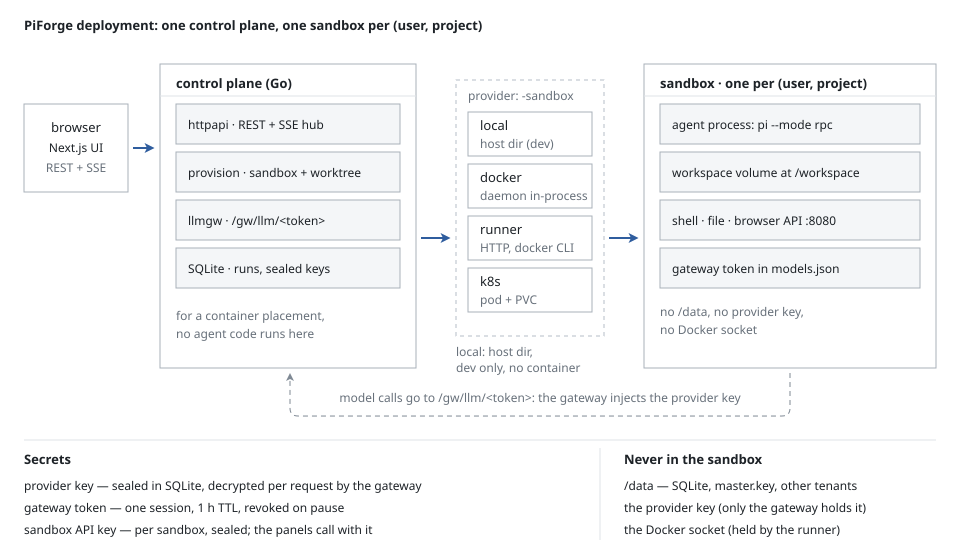

One browser session talks to one control plane. The control plane owns the database, the model
gateway and the agent processes; the sandbox owns the workspace. Everything the agent does —
its files, its shell, its browser — happens on the sandbox side.

A message goes: `POST /v1/sessions/{id}/messages` → resolve the model → spawn or reattach the
agent → the agent calls back through the gateway with a token bound to its own sandbox → the
control plane checks signature, revocation, source address and an HMAC proof, then calls the
real provider with the real key → the response streams back to the agent → the agent's RPC
events are persisted and broadcast over SSE.

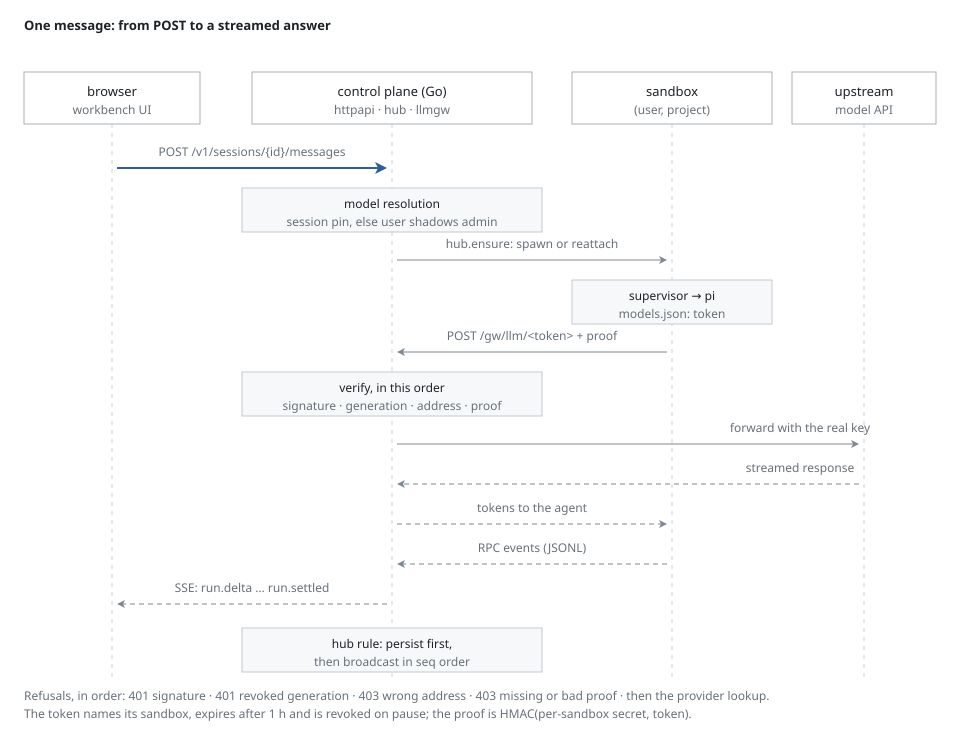

The model token inside the sandbox is worth nothing outside it: copied to the host, to a
sibling sandbox or to another tenant it gets a 403. The provider key never enters the sandbox.

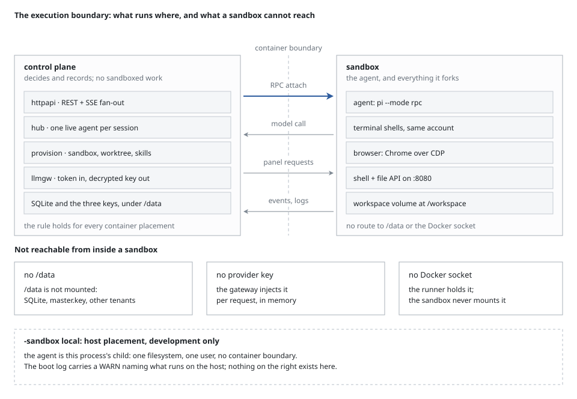

Four things cross the boundary — the agent's RPC stream, its model call, panel requests and
events. The database, the provider key and the Docker socket stay on the other side.

## Running it

Requires Docker Engine 25+, `git`, and Go 1.25+ if you build from source.

A release publishes three images, built by [`.github/workflows/release.yml`](.github/workflows/release.yml)
from the recipes in this repository:

| image | what it runs |
|---|---|
| `ghcr.io/potterluo/piforge` | the control plane and the web app |
| `ghcr.io/potterluo/piforge-runner` | the sandbox runner, the only service that holds `docker.sock` |
| `ghcr.io/potterluo/piforge-sandbox-agent` | what a sandbox runs (`PIFORGE_SANDBOX_IMAGE`) |

```bash
docker pull ghcr.io/potterluo/piforge:latest
docker run -d --name piforge -p 7722:7700 --cap-drop DAC_OVERRIDE \
  -v piforge-data:/data \
  -e PIFORGE_SANDBOX=local \
  -e PIFORGE_SEED_EMAIL=admin@example.com -e PIFORGE_SEED_PASSWORD='<set one>' \
  -e PIFORGE_BOOTSTRAP_PROVIDER_KEY='<your provider key>' \
  ghcr.io/potterluo/piforge:latest
```

`PIFORGE_SANDBOX` and a provider key are the two things it cannot guess. `/data` is the volume
holding the database and the workspaces, and the app listens on 7700 inside the container. Tags
are `latest` plus the version (`:1.2.3`, `:1.2`); a pre-release tag never moves `latest`.

Or build the same three images from source:

```pwsh
# PowerShell
$env:PIFORGE_BOOTSTRAP_PROVIDER_KEY = "<your provider key>"
pwsh scripts/up-isolated.ps1          # builds three images, runs a preflight, starts the stack on :7723
```

```bash
# bash; same script, same result
export PIFORGE_BOOTSTRAP_PROVIDER_KEY="<your provider key>"
pwsh scripts/up-isolated.ps1 -Port 7723
```

It prints the URL and the seeded accounts. `-Down` stops it, `-Rebuild` forces a rebuild. The
script refuses to start a stack whose images were built from a different source digest than the
working tree.

There is no default placement. Starting the control plane without `-sandbox` (or
`PIFORGE_SANDBOX`) is a startup error; `-sandbox local` is the development placement, where the
agent runs next to the control plane on the host with no container boundary. The container
shape, for reference:

```pwsh
docker build --build-arg INSTALL_CHROMIUM=true -t piforge:local .
docker run -d --name piforge -p 7722:7700 --cap-drop DAC_OVERRIDE `
  -v piforge-data:/data -e PIFORGE_SANDBOX=local -e PIFORGE_PORT=7700 -e PIFORGE_DATA=/data `
  -e PIFORGE_SEED_EMAIL=admin@example.com -e PIFORGE_SEED_PASSWORD='<set one>' `
  -e PIFORGE_DEFAULT_PROVIDER=volc piforge:local
```

`docs/HANDOFF.md` is the operator view: flags, data layout, keys, backup, restart behaviour,
and the commands behind every number below.

## What it looks like

All of these come from a running deployment with a real model — `e2e/scripts/public-shots.mjs`
drives it, and [`docs/screenshots/live/README.md`](docs/screenshots/live/README.md) says what
each one shows.

| | |
|---|---|
| 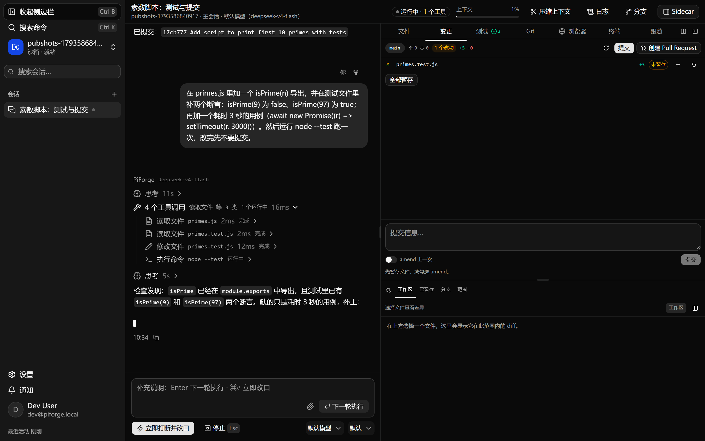 | 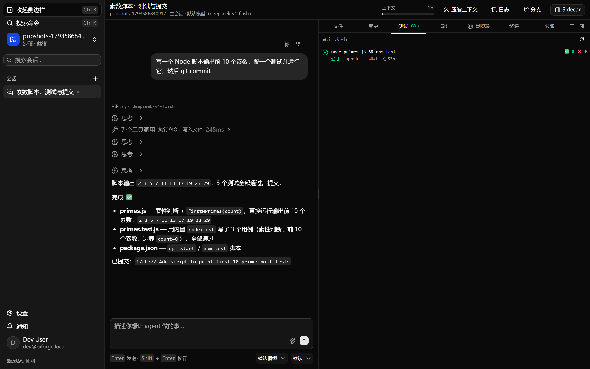 |
| A run in flight: streamed text, a live tool call, stop/queue on the composer. | The test panel after the agent ran `node --test`: counts, duration, the command. |
| 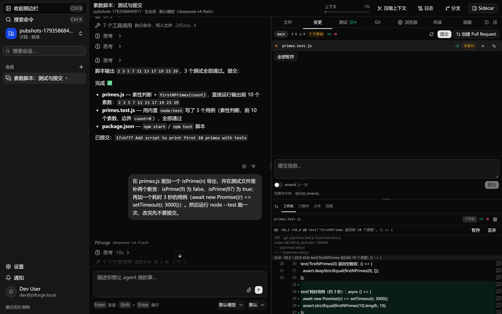 | 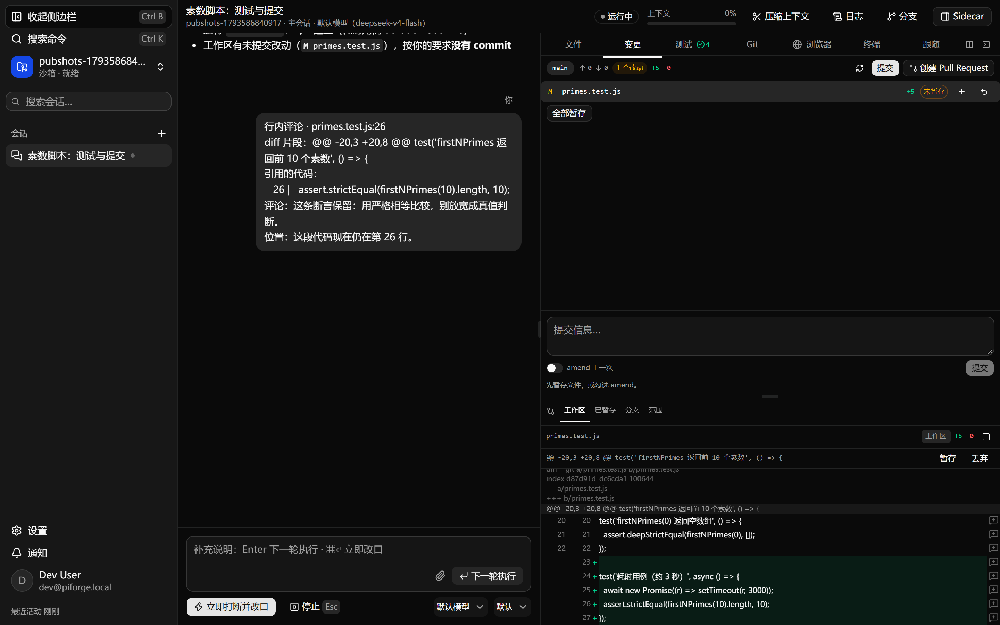 |
| Changes with a scoped diff and per-file `+N/−N`. | An inline comment: the quote reaches the agent with path, line and current position. |
| 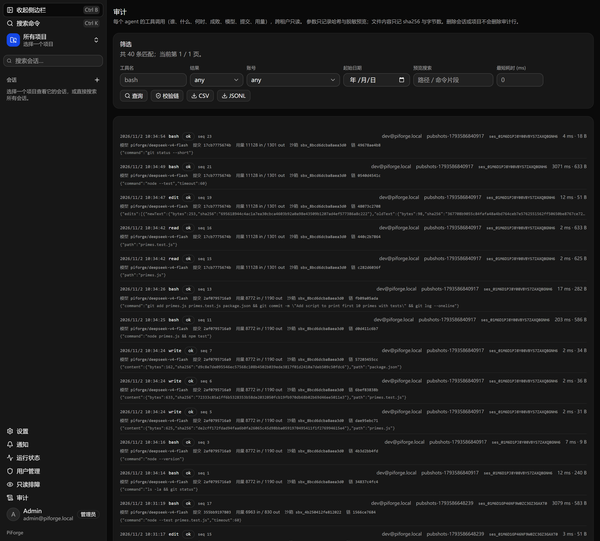 | 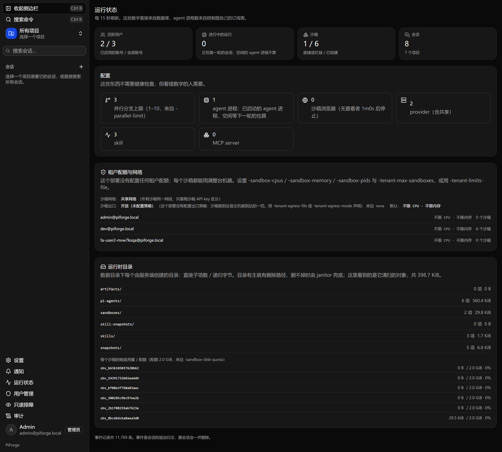 |
| `/admin/audit`: every tool call with model, commit, duration, tokens, redacted arguments. | `/admin/status`: runtime directories, per-sandbox quota, tenant limits, egress mode. |

More in [`docs/screenshots/live/`](docs/screenshots/live) and the older
[`docs/screenshots/`](docs/screenshots) set.

## Tenancy

One sandbox per (user, project). Each tenant gets its own Docker network, joined only by the
control plane and the runner, so a sandbox cannot reach another tenant's sandbox or the control
plane's own port. Egress is closed by default: a sandbox reaches the model gateway and nothing
else, and the agent keeps working because the gateway is what it needs.

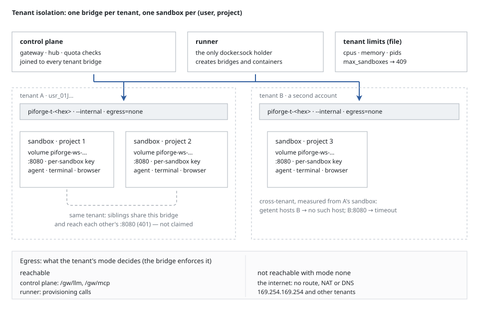

Quotas are per tenant — cpu, memory, pids, maximum concurrent sandboxes — and enforced when the
container is created; a refusal is a typed `409` naming the limit. Disk is bounded per sandbox
by `RLIMIT_FSIZE` plus an in-sandbox enforcer.

Every directory under the data volume has an owner and a reclaim path: an eager delete when its
session or project goes, and a janitor pass for what a crash left behind.

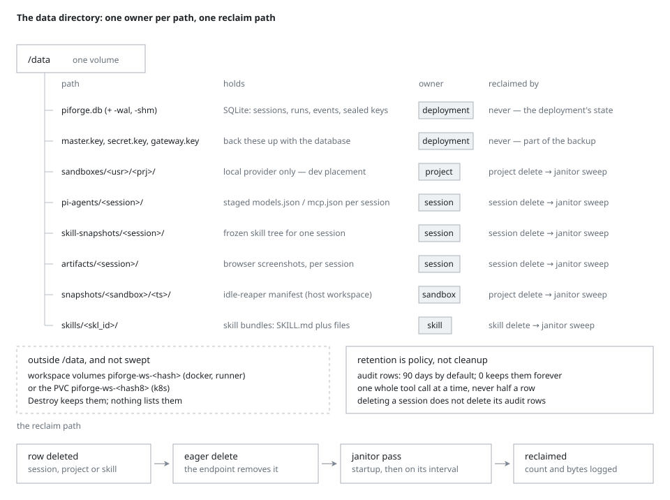

## The run lifecycle

A run ends with exactly one terminal state, and the control plane writes which one: `agent_settled`,
a user stop, a reconciliation pass after the process died, or a restart with a reattach. The
transcript says which happened and what survived, including the case where the sandbox is gone
and nothing can be continued.

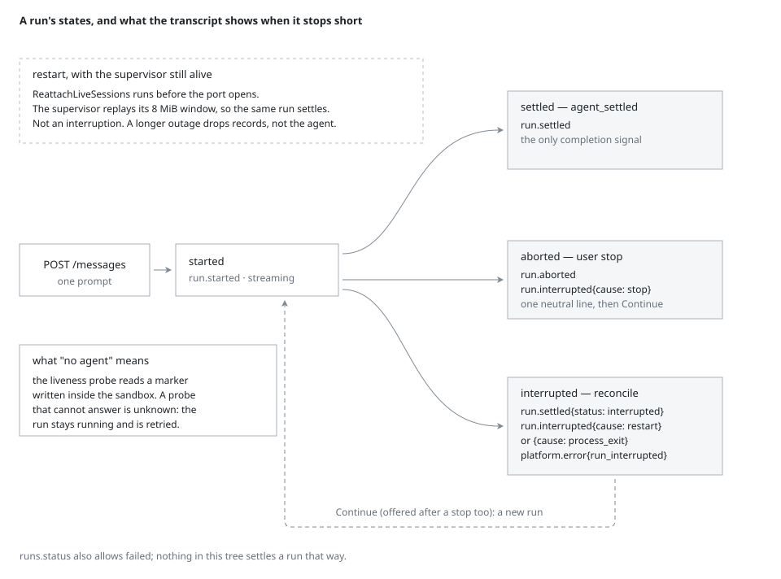

## How it is verified

| Gate | Command | Last result |
|---|---|---|
| Backend | `cd backend && go test ./... -count=1` | 45 packages, no failures |
| Web unit | `pnpm --dir web test -- --run` | 307 tests in 42 files |
| End-to-end | `cd e2e && pnpm test` | 182 tests, 0 retries, 0 flaky |
| From zero | `pwsh scripts/deliver-check.ps1` | 125 checks: image → stack → real run → commit → test panel → PR → browser → inline comment → teardown |
| Lint | `pnpm --dir web lint` | 0 errors, 0 warnings |

The delivery drill starts from a throwaway volume and a seeded account, so it fails if the
product needs a step the documentation does not describe. `docs/STATUS.md` is the requirement
ledger: one row per promise, with the test that asserts it.

Isolation, tenancy and the credential boundary were attacked on purpose, six times. The
findings and their fixes are in `docs/EXECUTION-BOUNDARY.md`, `docs/DATA-FLOW-AUDIT.md` and
`docs/AUDIT.md`, including what the audit chain cannot prove.

## Limits

These are real, and they decide whether this fits:

- **One host.** Control plane, runner and sandboxes are containers on one Docker daemon. The
  Kubernetes provider exists and was run against a real cluster, but multi-host operation and
  the Linux-native checks in `docs/LINUX-VERIFY.md` are not signed off.
- **Containers, not microVMs.** A sandbox is a Docker container with `cap-drop ALL` plus five
  measured capabilities, `no-new-privileges`, no Docker socket and no host mounts. A kernel bug
  is the escape path; if your tenants are adversarial rather than merely untrusted, use gVisor
  or a VM runtime.
- **Same-tenant siblings share a bridge.** Isolation is per tenant, not per sandbox: one user's
  projects can reach each other's port. The sandbox API key rejects them, but they hold that
  network position.
- **Egress is all-or-nothing.** `none` (default) or `open`, per tenant. There is no hostname
  allow-list; that needs a filtering proxy, which is not built.
- **Audit is tamper-evident, not tamper-proof.** Rows are chained, so an edit or a deleted row
  shows up; anything with database write access can recompute the chain, because no HMAC key is
  kept.
- **Windows paths are exercised, native Linux is not.** `docs/LINUX-VERIFY.md` separates what ran
  in Linux containers from what needs a Linux host.

## Documents

| Document | Contents |
|---|---|
| [`docs/HANDOFF.md`](docs/HANDOFF.md) | run, operate, extend; keys and backup |
| [`docs/PRD.md`](docs/PRD.md) | what the product promises, in behavioural terms |
| [`docs/SANDBOX.md`](docs/SANDBOX.md), [`docs/SANDBOX-DEPLOY.md`](docs/SANDBOX-DEPLOY.md) | placements, images, isolation |
| [`docs/SANDBOX-K8S.md`](docs/SANDBOX-K8S.md) | Kubernetes provider and manifests |
| [`docs/EXECUTION-BOUNDARY.md`](docs/EXECUTION-BOUNDARY.md) | where agent code runs, and what was tried against it |
| [`docs/AUDIT.md`](docs/AUDIT.md), [`docs/DATA-FLOW-AUDIT.md`](docs/DATA-FLOW-AUDIT.md) | the audit trail; every tenant-input edge |
| [`docs/DELIVERY-DRILL.md`](docs/DELIVERY-DRILL.md) | the from-zero check, assertion by assertion |
| [`docs/STATUS.md`](docs/STATUS.md) | the requirement ledger |

## License

Apache-2.0. See [LICENSE](LICENSE) and [NOTICE](NOTICE).
